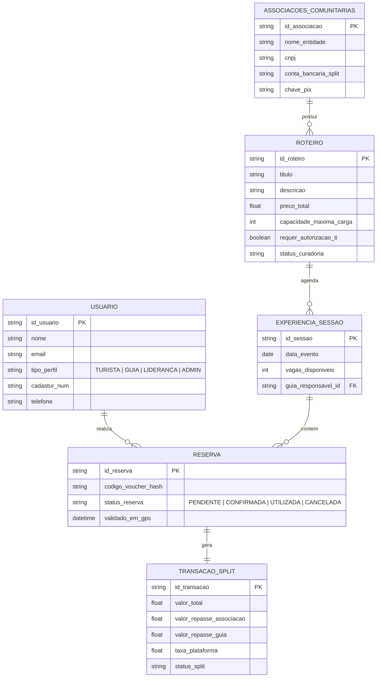
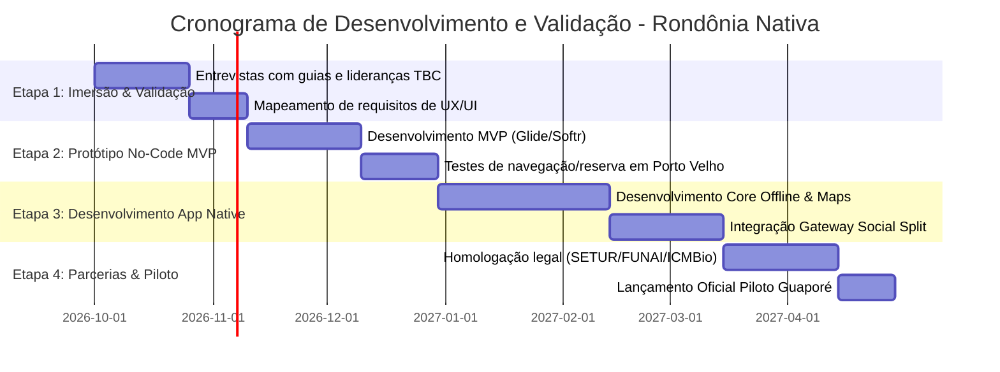

# ESPECIFICAÇÃO TÉCNICA E DE REQUISITOS DO PROJETO
## **Rondônia Nativa: Plataforma Integrada de Ecoturismo e Turismo de Base Comunitária**

> **Projeto:** Rondônia Nativa  
> **Programa:** Programa Centelha 3 Rondônia — Simulado Fase 1  
> **Proponente / Autor:** Eduardo Renan Souza de Aquino (3º Ano B - Técnico em Informática)  
> **Área do Conhecimento:** Desenvolvimento de Software, Geoprocessamento (GPS e Mapas Offline) e Tecnologia Ambiental  
> **Setor Econômico:** Turismo, Meio Ambiente e Tecnologia  
> **Data de Emissão:** Setembro de 2026  

---

## 1. VISÃO GERAL E OBJETIVOS DO PROJETO

### 1.1 Contexto e Justificativa
O estado de Rondônia possui um patrimônio natural, histórico e cultural de imenso valor na Amazônia Sul-Ocidental — incluindo o Real Forte Príncipe da Beira, a calha do Rio Guaporé, terras indígenas e comunidades tradicionais (ribeirinhas, indígenas e quilombolas). No entanto, o turismo sustentável e de base comunitária enfrenta um grave gargalo de comercialização, visibilidade e digitalização:
* Ausência de um canal digital centralizado e seguro para descoberta, reserva e agendamento de vivências sustentáveis.
* Dificuldades de conectividade em áreas de floresta e comunidades remotas (ausência de sinal celular/internet móvel).
* Plataformas globais (Airbnb Experiências, TripAdvisor) inadequadas à realidade local (taxas elevadas em moeda estrangeira, exigência de conexão contínua de internet, desconhecimento/negligência das regras ambientais e territoriais da FUNAI e ICMBio, além de ignorarem a logística da floresta).

### 1.2 Objetivo Geral
Desenvolver uma solução tecnológica integrada (Aplicativo Mobile Offline-First + Portal Web Marketplace) dedicada ao ecoturismo e turismo de base comunitária (TBC) em Rondônia, conectando turistas de aventura/experiência a guias locais credenciados e comunidades tradicionais de forma direta, segura, legalizada e sustentável.

### 1.3 Objetivos Específicos
1. **Digitalizar a oferta local:** Permitir o cadastro simples e autônomo de roteiros e vivências por guias credenciados e lideranças comunitárias (trilhas ecológicas, vivências culturais, passeios de barco e gastronomia local).
2. **Garantir navegação e validação off-grid:** Implementar arquitetura *Offline-First* com mapas baixáveis (vetoriais/tiles via GPS) e vouchers digitais em QR Code validados sem necessidade de conexão com a internet.
3. **Fomento Econômico Direto (Pagamento Social Split):** Automatizar a divisão de receitas (*split payment*) para crédito direto e transparente nas contas bancárias/Pix das associações comunitárias parceiras e guias locais.
4. **Proteção Socioambiental e Territorial:** Integrar travas rígidas de capacidade de carga turística (limite obrigatório de vagas por período) e curadoria especializada de conformidade com normativas de órgãos fiscalizadores (FUNAI, ICMBio, SETUR-RO).

---

## 2. ARQUITETURA DA SOLUÇÃO E STACK TECNOLÓGICA

```
+-----------------------------------------------------------------------+
|                           RONDÔNIA NATIVA                             |
+-----------------------------------------------------------------------+
|  [ Turista (App/Web) ]  |  [ Guia Credenciado ]  |  [ Liderança TBC ]  |
+-----------------------------------------------------------------------+
                                   |
                                   v
+-----------------------------------------------------------------------+
|                    CAMADA DE APRESENTAÇÃO / UI                         |
|  - App Mobile (React Native / Flutter) - Android & iOS                |
|  - Web Portal (Next.js / React) - Dashboard Admin e Vitrine Web       |
+-----------------------------------------------------------------------+
                                   |
                                   v
+-----------------------------------------------------------------------+
|                CAMADA OFFLINE-FIRST & NAVEGAÇÃO                       |
|  - Local Store: WatermelonDB / SQLite (Sincronização diferida)         |
|  - Geoprocessamento: Leaflet / Mapbox / OpenStreetMap Tiles Cache     |
|  - Offline Voucher Engine: QR Code criptografado com verificação GPS  |
+-----------------------------------------------------------------------+
                                   |
                                   v
+-----------------------------------------------------------------------+
|                      SERVIÇOS DE BACKEND & API                        |
|  - API REST / GraphQL (Node.js / Python / Supabase)                   |
|  - Split Payment Gateway (Asaas / Pagar.me / Mercado Pago Split)      |
|  - Curadoria & Validação Legal (FUNAI / ICMBio / Cadastur SETUR-RO)    |
+-----------------------------------------------------------------------+
```

### 2.1 Componentes Tecnológicos Detalhados
* **Mobile Frontend (Android/iOS):** React Native ou Flutter. Suporte nativo a geolocalização por GPS e armazenamento offline local com sincronização automática quando conectado.
* **Web Frontend (Portal Web & Admin):** Next.js / React (Catálogo público SEO-friendly, painel de controle para gestores, guias e associações).
* **Banco de Dados Local (Mobile):** WatermelonDB ou SQLite com motor de sincronização bi-direcional resiliente (Sync Engine).
* **Banco de Dados Cloud / Backend API:** PostgreSQL (Supabase / Node.js API), responsável por gerenciar usuários, catálogos, controle de estoque de vagas e logs de transação.
* **Geoprocessamento e Mapas Offline:** Mapbox Mobile SDK / OpenStreetMap com cache de ladrilhos (tiles mbtiles) para visualização e navegação offline em áreas de mata.
* **Gateway de Pagamento Social Split:** Asaas ou Pagar.me API com repasse automático (*split payment*) para subcontas Pix/TED de associações comunitárias e guias credenciados.

---

## 3. REQUISITOS FUNCIONAIS (RF)

| ID | Requisito | Descrição Detalhada |
|:---|:---|:---|
| **RF01** | **Gestão de Perfis e Acesso** | Permite cadastro e autenticação para 4 perfis distintos: Turista, Guia Local Credenciado (com validação de Cadastur), Liderança Comunitária / Associação e Administrador Geral. |
| **RF02** | **Cadastro de Roteiros e Vivências** | Interface para cadastro de experiências (trilhas, vivências culturais em aldeias/quilombos, passeios de barco, gastronomia local), com upload de mídias, descrição, exigências físicas e precificação. |
| **RF03** | **Validação de Conformidade Legal e Territorial** | Módulo de curadoria prévia onde roteiros situados em Terras Indígenas (TI) ou Unidades de Conservação (UC) exigem anexação e verificação de autorizações da FUNAI e ICMBio. |
| **RF04** | **Controle de Capacidade de Carga Turística** | Definição obrigatória do limite máximo de visitantes por período/data para cada atração, bloqueando automaticamente novas vendas ao atingir a capacidade pactuada com as comunidades. |
| **RF05** | **Busca, Agendamento e Reserva** | Filtro de roteiros por localização geográfica, tipo de experiência e datas disponíveis, permitindo o agendamento direto pelo turista. |
| **RF06** | **Pagamento Social Split** | Processamento seguro de pagamentos. O valor transacionado é dividido (*split*) automaticamente entre a Associação Comunitária (fortalecimento local), o Guia Credenciado e a taxa de manutenção da plataforma. |
| **RF07** | **Módulo Offline-First (Mapas e Vouchers GPS)** | Permite o download prévio do pacote do roteiro (mapa vetorial e voucher com QR Code criptografado), garantindo acesso completo sem conexão à internet móvel. |
| **RF08** | **Validação Offline de Vouchers pelo Guia** | O aplicativo do guia permite leitura e validação do QR Code do turista offline, registrando a validação com timestamp e coordenada GPS no dispositivo para posterior sincronização. |
| **RF09** | **Manual de Conduta Ética Obrigatorio** | Apresentação de um termo/checklist de conduta socioambiental antes da confirmação da reserva (respeito às regras culturais, manejo de resíduos, preservação da fauna e flora). |
| **RF10** | **Avaliações e Feedback Sustentável** | Sistema de avaliação pós-viagem cobrindo qualidade da experiência, atuação do guia, hospitalidade comunitária e cumprimento das normas socioambientais. |

---

## 4. REQUISITOS NÃO-FUNCIONAIS (RNF)

* **RNF01 - Operação Off-Grid:** O aplicativo mobile deve operar com 100% de autonomia funcional nas tarefas de visualização de mapas baixados, rastreamento via GPS e exibição de vouchers em áreas sem sinal de internet.
* **RNF02 - Desempenho e Armazenamento Otimizado:** Footprint reduzido do app (< 80 MB download base) e gestão eficiente de armazenamento de ladrilhos de mapas offline para compatibilidade com celulares de entrada.
* **RNF03 - Acessibilidade e Usabilidade:** Interface intuitiva, limpa e com elementos visuais claros, facilitando o manuseio por guias e lideranças locais com diferentes níveis de letramento digital.
* **RNF04 - Segurança e Proteção de Dados (LGPD):** Criptografia de ponta a ponta (AES-256 / SSL/TLS) nos dados pessoais e transações bancárias, em conformidade total com a Lei Geral de Proteção de Dados.
* **RNF05 - Sincronização Diferida Resiliente:** Mecanismo de sincronização preparado para operar em conexões oscilantes (2G/EDGE ou Wi-Fi comunitário), garantindo a integridade dos dados sem duplicação de transações.

---

## 5. REGRAS DE NEGÓCIO (RN)

* **RN01 - Acompanhamento Obrigatório por Guia Credenciado:** Toda experiência cadastrada em áreas protegidas deve obrigatoriamente contar com um guia local com registro Cadastur ativo.
* **RN02 - Inviolabilidade da Capacidade de Carga:** O sistema não permitirá em nenhuma hipótese a emissão de ingressos além do limite de capacidade de carga configurado para o roteiro.
* **RN03 - Trava de Autorização de Terras Protegidas:** Roteiros em terras indígenas ou Unidades de Conservação permanecerão com status "Pendente" até a aprovação documental expressa das lideranças locais e órgãos competentes (FUNAI/ICMBio).
* **RN04 - Transparência Financeira no Repasse:** O comprovante de compra gerado para o turista exibirá de forma clara e discriminada a porcentagem repassada diretamente à Associação Comunitária parceira.
* **RN05 - Aceite Ético Mandatório:** O encerramento da compra exige a confirmação de leitura do Manual de Conduta Ética e Socioambiental.

---

## 6. MODELAGEM DE DADOS (ENTIDADES PRINCIPAIS)



---

## 7. PLANO DE EXECUÇÃO E DEPLOYMENT (ROADMAP EM 4 ETAPAS)



### Detalhamento das Etapas de Execução:
1. **Etapa 1 - Imersão e Validação:**  
   Realização de entrevistas e questionários com guias credenciados e lideranças comunitárias para mapear desafios técnicos, modelos de smartphones utilizados e rotinas operacionais locais.
2. **Etapa 2 - Protótipo No-Code (MVP Simplificado):**  
   Desenvolvimento de um MVP em ferramentas No-Code (*Glide* ou *Softr*) para validar os fluxos de navegação e agendamento offline com um grupo reduzido de usuários em Porto Velho.
3. **Etapa 3 - Desenvolvimentos Estruturais e Plataforma Nativa:**  
   Programação do aplicativo mobile offline-first e do portal web. Implementação dos motores de mapa vetorial GPS, validação offline por QR Code e integração do gateway de pagamento com split social.
4. **Etapa 4 - Parcerias Estruturais e Apoio Legal/Técnico:**  
   Estabelecimento de parcerias com a SETUR-RO, agências locais e órgãos ambientais/indigenistas (FUNAI/ICMBio), seguido do lançamento do projeto piloto na região do Rio Guaporé e Forte Príncipe da Beira.

---

## 8. ANÁLISE DE IMPACTO E MITIGAÇÃO DE RISCOS SOCIOAMBIENTAIS

| Categoria | Risco Identificado | Ação Mitigadora na Plataforma |
|:---|:---|:---|
| **Impacto Ambiental** | Turismo predatório, degradação de trilhas e perturbação da fauna local. | Trava algorítmica inviolável de capacidade de carga turística diária + obrigatoriedade de acompanhamento por guia credenciado. |
| **Impacto Cultural** | Desrespeito às tradições e rotinas de comunidades indígenas/ribeirinhas. | Exigência de leitura e aceite do Manual de Conduta Ética + curadoria prévia do roteiro pelas próprias lideranças comunitárias. |
| **Risco Tecnológico** | Turista sem acesso ao voucher em área remota sem internet. | Geração de voucher com token criptografado armazenado localmente no dispositivo (arquitetura offline-first). |
| **Risco Financeiro/Legal** | Dificuldade de repasse de valores para comunidades sem infraestrutura bancária convencional. | Arranjo de pagamento automatizado via PIX para contas jurídicas de Associações Comunitárias locais. |

---

## 9. CRITÉRIOS DE AVALIAÇÃO CENTELHA ATENDIDOS

* **Solução (Peso 2):** Solução tecnológica inovadora adaptada às especificidades da floresta (tecnologia *offline-first*), aliada ao mecanismo inédito de *Social Split Payment* e curadoria territorial automatizada.
* **Mercado (Peso 1):** Captura a crescente demanda global por turismo sustentável, ecoturismo e turismo de imersão cultural, posicionando Rondônia como um polo ecológico na Amazônia.
* **Impacto (Peso 1):** Valorização da "floresta em pé", gerando renda direta para famílias ribeirinhas, indígenas e guias locais, contendo a conversão florestal e promovendo a inclusão sócio-digital dos jovens.
* **Execução (Peso 1):** Plano de ação realista estruturado em 4 etapas (da validação em no-code à solução mobile nativa), suportado pelos conhecimentos técnicos do estudante em desenvolvimento de software e usabilidade.
